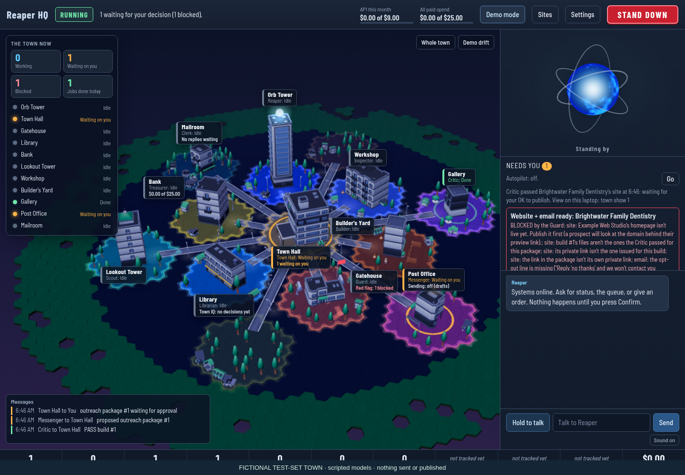
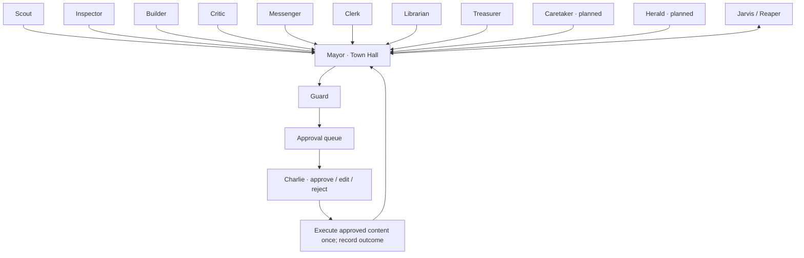
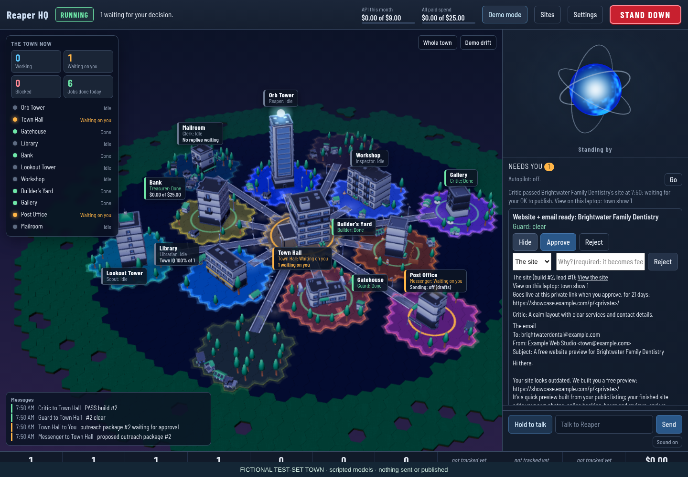
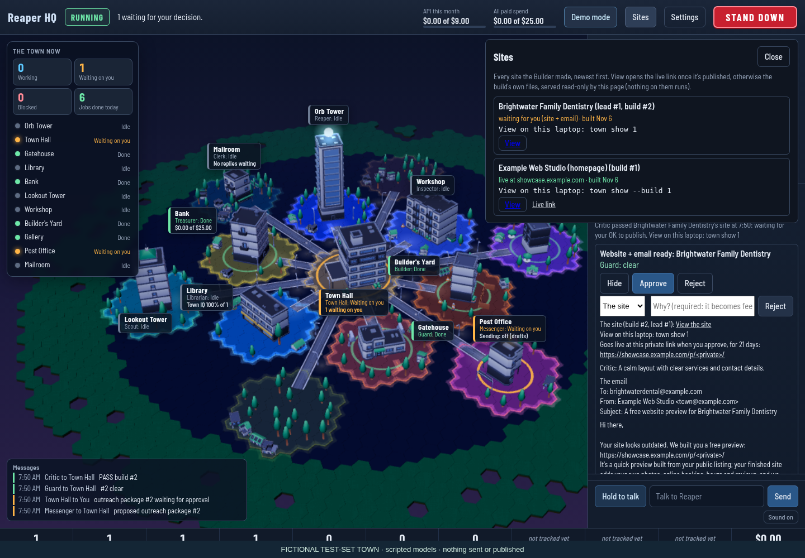
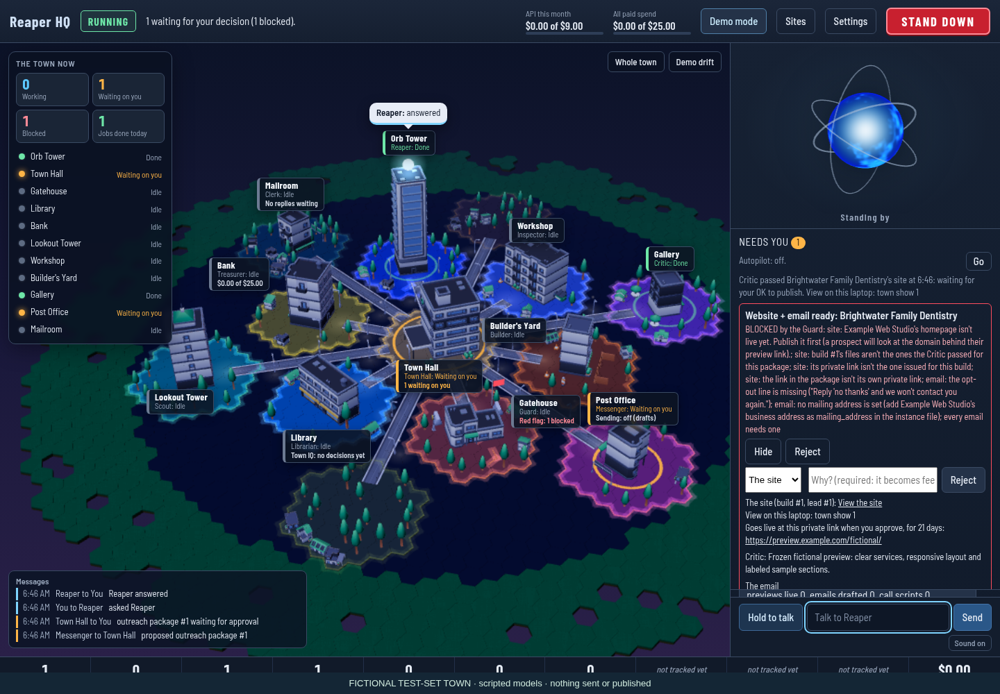
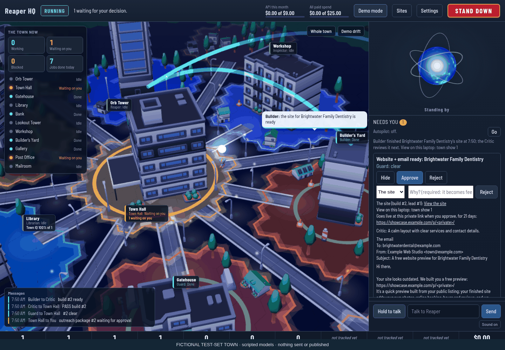

# The Town

A real website business run by AI agents, with one human approval per prospect.
The agents find businesses that need a better website, build a private sample,
check it, and prepare the first email. Charlie reviews the site and email as one
outreach package. Only his approval can publish that preview and release its email.

This is the public engineering showcase. All businesses shown here are fictional
test-set businesses. Operational records, credentials and private history are excluded.



## How it works



Those are the 13 agent roles. Several are mostly plain code; Caretaker and Herald
are planned roles, not finished autonomous workers. Reaper is the human interface.
The Mayor owns the queue and routes every handoff.

One prospect flows through **Scout → Inspector → Builder → Critic → outreach
package → Charlie → send → Clerk**. Scout uses licensed Overture Maps data and
saves only candidates that pass deterministic checks. Inspector measures the
website. Builder makes a sample; Critic can send it back. Messenger drafts the
email against that exact build. An approval publishes the approved files, checks
the preview is reachable and correct, then delivers the approved email. If
publishing fails, there is no email. If email delivery fails, it is never retried
automatically. Follow-ups still need their own approval. Clerk reads replies on
Town threads, honors opt-outs and brings questions back to Charlie.

## Safety is part of the engine

- Every outside action needs an approved database item. Approval binds the content
  and build hash; execution rechecks them and records the result.
- The Guard's address, account, do-not-contact, budget and daily-cap rules are
  plain code. A model can add a warning and cannot clear a block.
- A kill switch stops agents and execution. Only the human can resume the Town.
- A separate human-operated go-live switch requires logged shadow days and the
  launch checklist. Before that, approved emails become drafts, not sends.
- Gmail uses only `gmail.compose` and `gmail.readonly`. An explicit call allowlist
  permits profile, draft creation/listing, message/thread reads, and one
  `drafts.send` path in the Outbox, with no automatic send retry.
- Reaper may only ever call Charlie. Prospect calls belong to the human. Phone
  automation is planned; there is no AI cold-calling feature.
- Development and screenshots use throwaway instances and fake external clients.
  HQ is a local interface to the same queue and log, not another permission system.

## Models, cost and memory

Small jobs use **Haiku through the Anthropic API**, at fractions of a cent for
small requests under the configured token rates. Building and judging use **Opus
through `claude -p`**; writing uses **Sonnet through `claude -p`**. Model routing
lives in the pack configuration. The subprocess removes `ANTHROPIC_API_KEY` so
subscription jobs do not silently become API charges.

1,190 tests collected in the private source checkout; 13 agent roles. 26 saved leads; 22 completed non-test builds. Measured lifetime Haiku API spend: $0.024318; amortized per build: $0.001105; per saved lead: $0.000935.

The exported counts are aggregates only. Cost per build and per lead, when
present, divide lifetime logged Haiku API spend by completed non-test builds and
saved leads respectively. These are amortized figures, not a traced marginal
cost for one prospect. They include other Haiku work and exclude the Claude
subscription, hosting, human time and hypothetical API-equivalent build prices.
The test count is collection from the source checkout, not a claim that every
test passed or every test is in the public snapshot. `docs/stats.json` records it.

The Town does not retrain a model. It keeps events, decisions, rejection reasons
and edits as evidence. The Librarian proposes short lessons; a playbook change
needs evidence, a before/after test-set score that does not decline, and human
approval. Only that approved action can write a playbook. Public playbooks are
clean baselines, not copies of private learned business decisions.

## Look around










Images are captured at 1440 pixels wide on a temporary fictional Town. Models are
scripted and the synthetic preview is a frozen test fixture, not a live customer
build. The fictional homepage is approved and published only to the fake adapter;
the prospect package remains unapproved. No real email or publication occurs.
If images are absent, generate them in the private checkout with
`python tools/showcase_media.py`, then make a new export. See `ARCHITECTURE.md`
for the implementation map.

## Stack and local checks

Python 3.12+, SQLite, Typer, FastAPI and uvicorn; plain JavaScript, three.js and
Kenney CC0 art for HQ; Astro and Tailwind for preview sites; Playwright,
Lighthouse and axe for checks; pytest for tests. The runtime uses Anthropic's API,
the official Claude CLI, Gmail's REST API and Cloudflare Pages behind the gates.
The engine has no imports from the website business pack.

```sh
pip install -e ".[dev]"
npm ci --prefix hq
npm ci --prefix packs/websites/site_template
pytest -m "not hq_browser"
```

Browser checks also need `python -m playwright install chromium`.
The public snapshot has fictional numeric placeholder prices (not real offers),
an example instance and no credentials or business state. It is for inspection
and fictional tests. It is not configured to operate a business. Keep real data
out of this repository. There are no real preview links to open.

## What's next

Finish replay and the demo walk-through, local speech recognition and a morning
briefing to Charlie; measure operator time and conversion outcomes over shadow
days; extend the Clerk, Caretaker and Treasurer as the business needs them. The
approval gate remains the spine of that work.

Built by Charlie Baker (WashU Olin).

All rights reserved. No license is granted for the original project code.
Third-party assets and bundled materials retain their own notices and terms;
Kenney's village art is CC0. There is no project license file.
